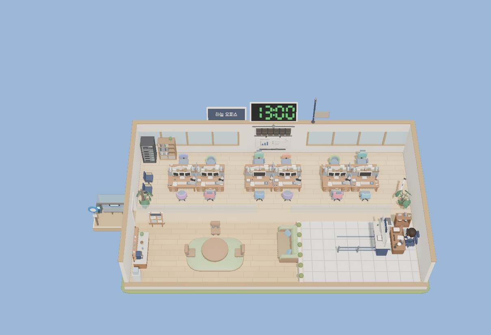
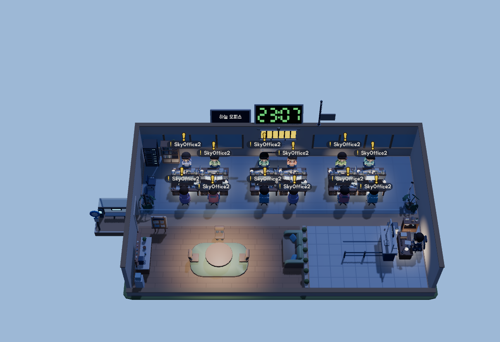
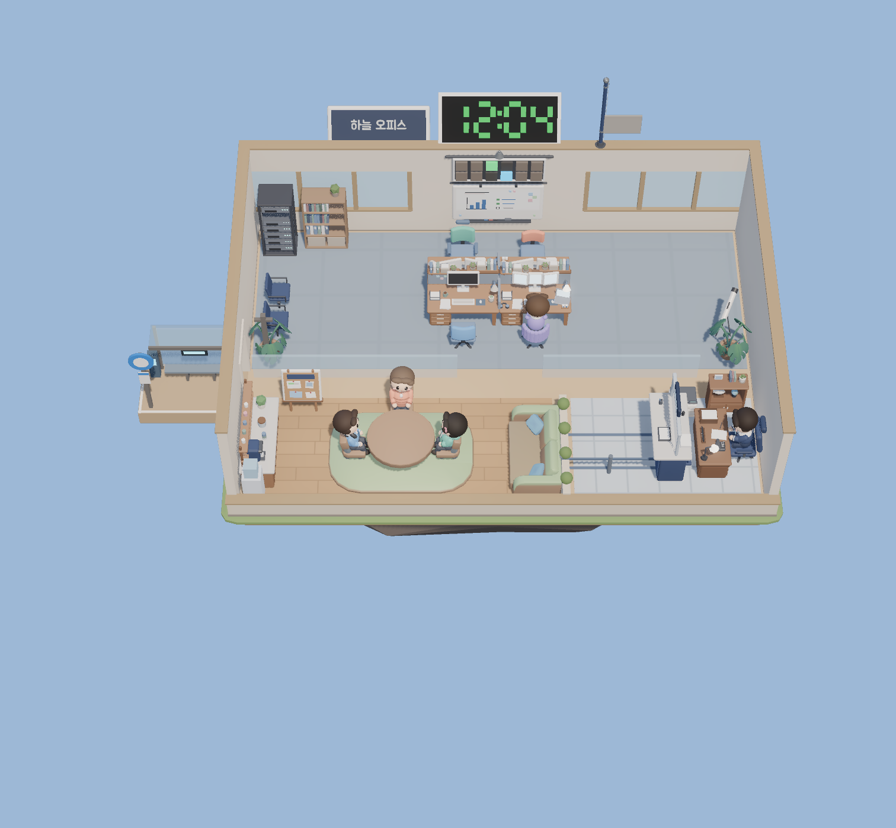
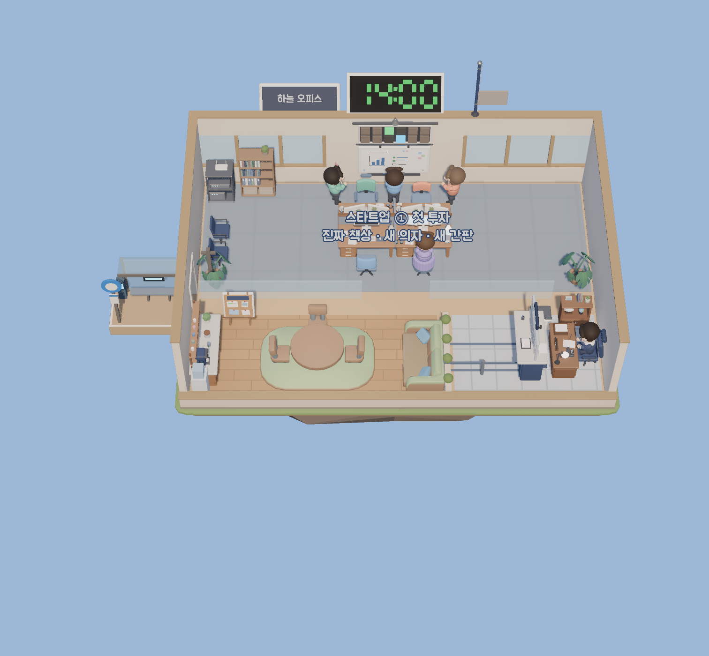
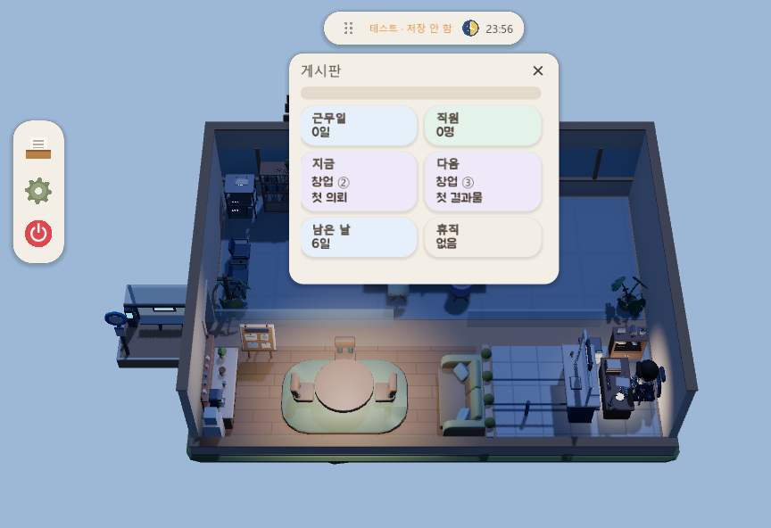
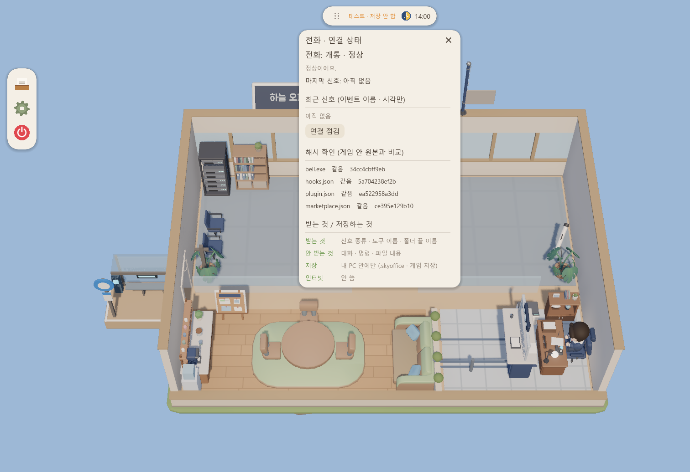

<div align="center">

# ☁️ 하늘 오피스 (Sky Office)

**Claude Code 에이전트가 일하는 모습을, 하늘에 뜬 작은 사무실로 보는 바탕화면 게임**
나는 사장, 직원은 AI 에이전트예요.

[**⬇ 받기 (릴리스)**](https://github.com/Dawnilove/Sky_Office/releases) · Windows 11 x64 · MIT · v0.1.0



</div>

> Claude Code 와 함께 쓰는 팬 게임이에요. Anthropic 과 제휴 · 보증 관계가 아니에요. (지금은 **Claude Code 만** 지원)

## 이런 게임이에요

Claude Code 세션 하나가 직원 한 명이에요. 일을 시키면 직원이 책상에서 일하고, **내 차례** (허락 · 질문) 가 오면 노란 알림으로 불러요. 터미널을 계속 들여다보지 않아도, 섬을 흘끗 보면 돼요.

| | |
|---|---|
|  |  |
| **내 차례 알림** — 허락 · 질문이 오면 직원 머리 위에 노랑 느낌표와 명패 | **회사 생활** — 아침 조회 · 점심 · 쉬는 직원의 잔잔한 움직임 (끌 수 있어요) |
|  |  |
| **회사 성장** — 근무일이 쌓이면 6단계로 사무실이 커져요 | **게시판** — 근무일 · 직원 · 다음 단계까지 한눈에 |

- 명패 (이름 · 작업 폴더) · 호출 보드 · 서브에이전트가 끝나면 날아오는 봉투
- 하루 = Claude 5시간 창 (낮 → 밤), 합성 환경음, **조용히 모드**, 자동 업데이트

## 설치 · 연결 · 제거

1. **받기**: [릴리스](https://github.com/Dawnilove/Sky_Office/releases) 에서 `SkyOffice-버전-windows-x64.zip` → **모두 압축 풀기**
2. **켜기**: `SkyOffice.exe` 두 번 클릭 → 회사 이름 · 직원 이름 정하기
3. **연결** (선택, 약 1분): 사장 책상의 **전화기** → **[개통하기]** → 하늘색 불이 들어오면 끝
   - `claude 명령을 못 찾았어요` → **[명령 복사]** → Claude Code 를 쓰는 **PowerShell** 에 붙여 넣고 Enter (2줄)
   - 열려 있던 Claude Code 는 **껐다 다시 켜기**
4. **확인**: Claude Code 에서 아무 일이나 시키면 직원이 움직여요
5. **제거**: 설정 → 회사 → 맨 아래 **폐업 정리** (플러그인 · 저장 · 자동 실행 삭제) → 게임 폴더는 직접 삭제

개통 전에는 **관찰 모드**로 동작해요 (Claude Code 기록 파일의 수정 시각만 봐요).

| 전화기 | 뜻 |
|---|---|
| 회색 불 | 미개통 (관찰 모드) |
| 하늘색 불 | 개통 · 정상 |
| 수화기 내려감 + X | 불통 — 전화기를 누르면 원인 1줄 |

## 개인정보 · 안전



| | |
|---|---|
| 받는 것 | 신호 종류 · 도구 이름 · 폴더 끝 이름 |
| 안 받는 것 | 프롬프트 · 명령 · 파일 내용 · 대화 · 오류 문장 · 환경 변수 |
| 저장 | 내 PC 안에만 (`%USERPROFILE%\.skyoffice` · `%APPDATA%\SkyOffice`) |
| 인터넷 | 안 써요 (게임은 업데이트 확인만) |

- 훅 11개 모두 출력 없음 · 결정 권한 없음. **게임에는 승인 버튼이 없어요**
- 무결성: 켤 때마다 설치 파일 4개의 SHA-256 을 게임 안 원본과 비교해요. 다르면 불통 + 신호 처리 중단
- `bell.exe` SHA-256: `34cc4cbff9ebf8b2136c24db7f23f104d761fbd46b3b3c6874f2ad5b37695e9a` (소스: `m0/bell`, C# NativeAOT)

직접 개통 / 제거 (PowerShell):

```powershell
claude plugin marketplace add "$env:USERPROFILE\.skyoffice\plugin\0.1.0"
claude plugin install skyoffice-bell@skyoffice --scope user
```

```powershell
claude plugin uninstall skyoffice-bell@skyoffice
claude plugin marketplace remove skyoffice
```

## 문제 해결

| 증상 | 해결 |
|---|---|
| 개통했는데 불이 안 들어옴 | Claude Code 를 다시 켜고 일을 하나 시키기 |
| 불통 '신호가 안 와요' | Claude Code 다시 켜기 → 전화기 [연결 점검] |
| 불통 '파일이 바뀌었어요' | 전화기 → [개통하기] 로 다시 개통 |

## 다음 버전 목표

- 사장 → PM → 전문가 분업 (서브에이전트별 직원)
- 밝은 사무실 마무리 (말풍선 · 그림자 · 소품), 새 배경음악
- (검토 중) Claude Code 외 도구 지원

## 개발자용

- Godot 4.7 .NET (`game/`) · 화면 없이 시험: `bash tools/offscreen_test.sh --scenario`
- 배포 빌드 `tools/build_release.sh` 는 서명 비밀 키가 있는 개발 PC 에서만 (공개 키 `tools/signing/update_public.pem`)
- 에셋 출처 · 라이선스: [game/assets/LICENSES.md](game/assets/LICENSES.md)

## 라이선스

MIT ([LICENSE](LICENSE)). 제3자 자료 — Godot Engine (MIT) · 주아 글꼴 (OFL 1.1) · CC0 에셋은 `game/assets/LICENSES.md`
